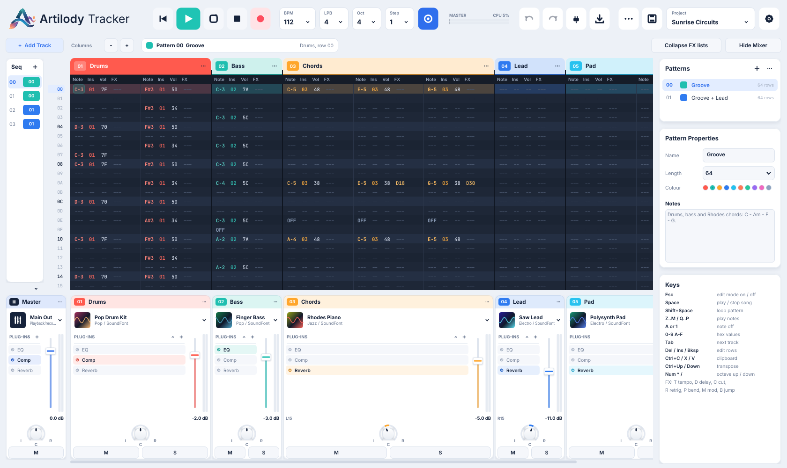
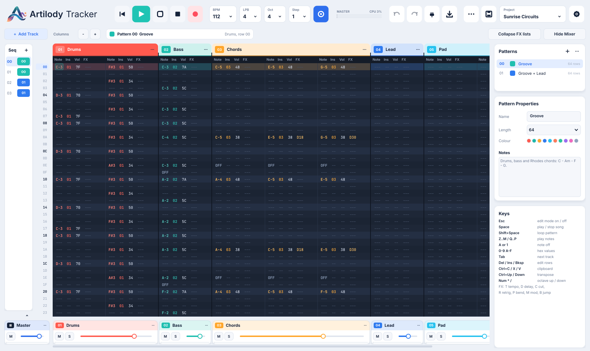

<p align="center"></p>

# Artilody Tracker

En pattern-baseret music tracker skrevet i C++ med [JUCE](https://juce.com).
Til forskel fra de fleste trackere har Artilody Tracker en rigtig mixer: når du opretter et track,
oprettes der automatisk en channel strip **lige under tracket**, som styrer det.



## Funktioner

**Tracker**
- Patterns med op til 512 linjer, flere note-kolonner pr. track (akkorder), kolonnerne Note / Ins / Vol / FX
- Song sequence (order list), pattern-liste og pattern-egenskaber (navn, længde, farve, noter)
- Keyboard-indspilning (Z–M / Q–P), MIDI-keyboard input, edit step, oktav, follow playback, loop pattern
- Copy / cut / paste, transponering, interpolering af volume, indsæt/slet linjer, undo/redo
- Effektkommandoer: `Txx` tempo, `Lxx` lines per beat, `Dxx` delay, `Cxx` cut, `Rxy` retrigger,
  `Pxx` pitch bend, `Mxx` modulation, `Bxx` hop i sekvensen

**Mixer**
- Master stereo channel strip
- En channel strip pr. track, placeret lige under tracket
- Hele mixeren kan kollapses (`Ctrl+M` eller *Hide Mixer*) for bedre overblik over trackene

**Channel strip**
1. **Instrument** – indbyggede genrer *Pop, Rock, Electro og Jazz* med forskellige SoundFont-instrumenter
   (trommesæt, bas, klaver, guitar, synth, blæsere …), alle presets i SoundFonten, egen `.sf2`,
   eller **VST3, AU (macOS) og CLAP** instrument plug-ins
2. **Plug-in effekter** – vilkårligt antal VST3 / AU / CLAP effekter; flyt op/ned, bypass, fjern,
   og kollaps listen så den fylder mindre
3. **Indbyggede effekter** – EQ (low cut + 3 bånd), kompressor og reverb; tænd/sluk og indstil
4. **Panorering**
5. **Lydstyrke** (fader med meter), mute og solo

Projekter gemmes som `.artilody` (inkl. plug-in-tilstand) og sange kan eksporteres til WAV.



## Installation

Hent den nyeste version under [Releases](https://github.com/shenphenchoedron-hue/Artilody-Tracker/releases):
Windows installer, macOS DMG samt `.deb`-pakker til Debian 12, Ubuntu 22.04 og Ubuntu 24.04.

## Tastatur

| Tast | Funktion |
|------|----------|
| `Esc` | Edit mode til/fra |
| `Space` / `Shift+Space` | Afspil sang / loop pattern (stop hvis den spiller) |
| `Enter` | Afspil fra markørens linje |
| `Z`…`M`, `Q`…`P` | Noder (to oktaver) |
| `A` eller `1` | Note off |
| `0-9`, `A-F` | Hex-værdier i Ins / Vol / FX |
| Piletaster, `Tab`, `PgUp/PgDn`, `Home/End` | Navigation |
| `Shift` + piletaster / mus-træk | Markering |
| `Del`, `Ins`, `Backspace` | Slet, indsæt linje, slet linje |
| `Ctrl+C/X/V`, `Ctrl+Z/Y` | Udklipsholder, fortryd |
| `Ctrl+↑/↓` (`+Shift` = oktav) | Transponér |
| `Num *` / `Num /`, `F1`/`F2` | Oktav op / ned |
| `Ctrl+S/O/N/E/T/M` | Gem, åbn, ny, eksporter, nyt track, mixer |

## Byg selv

Kræver CMake ≥ 3.22 og en C++17-compiler. JUCE hentes automatisk.

```bash
# Debian/Ubuntu afhængigheder
sudo apt install build-essential cmake libasound2-dev libfreetype-dev libfontconfig1-dev \
  libx11-dev libxcomposite-dev libxcursor-dev libxext-dev libxinerama-dev libxrandr-dev libxrender-dev

# valgfrit: den medfølgende General MIDI SoundFont
mkdir -p soundfonts
curl -L -o soundfonts/GeneralUser-GS.sf2 \
  https://raw.githubusercontent.com/mrbumpy409/GeneralUser-GS/main/GeneralUser-GS.sf2

cmake -S . -B build -DCMAKE_BUILD_TYPE=Release
cmake --build build -j
cd build && cpack -G DEB   # Linux-pakke
```

Uden den medfølgende SoundFont bruger appen en system-SoundFont (fx `/usr/share/sounds/sf2/FluidR3_GM.sf2`),
eller du kan vælge en under *Menu → Default SoundFont*.

## Licens

Kildekoden er under GPLv3 (se `LICENSE`). Binærfilerne linker til open source-udgaven af JUCE og er derfor
også underlagt AGPLv3. Se [THIRD_PARTY_LICENSES.md](THIRD_PARTY_LICENSES.md) for tredjepartskomponenter.
